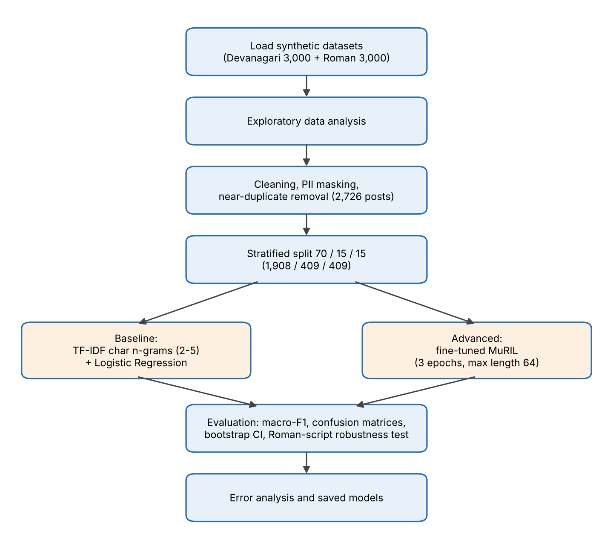
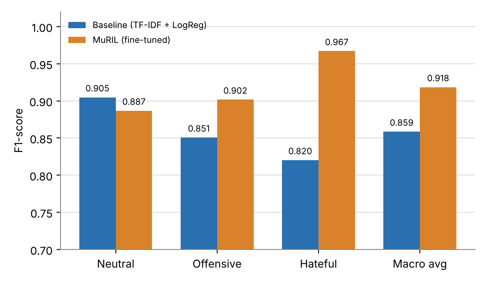
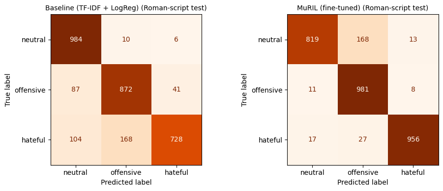

# Hate Speech and Offensive Content Detection in Marathi-English Code-Mixed Text

Three-class classification (**neutral / offensive / hateful**) of Marathi-English code-mixed posts, comparing a fast **TF-IDF + Logistic Regression** baseline with a fine-tuned **MuRIL** transformer, including a **Roman-script robustness test**.

> **Mini Project, Natural Language Processing (MAI23202), MTech Sem III, A.Y. 2026-27**
> Department of Computer Engineering, Vidya Pratishthan's Kamalnayan Bajaj Institute of Engineering and Technology (VPKBIET), Baramati
> **Guide:** Dr. Arvind M. Jagtap

**Authors:** Ganesh Dhananjay Kokare (EN25552015), Atharva Pravin Gurav (EN25552009)

> **Research prototype only.** Both datasets are synthetic. The results here must not be used for real content-moderation decisions. See [Limitations](#limitations).

---

## Overview

Social media users in Maharashtra often mix Marathi and English, in Devanagari or Roman script. This project:

1. Cleans and splits a synthetic Devanagari code-mixed dataset (3,000 posts, 2,726 after near-duplicate removal).
2. Trains a character n-gram TF-IDF + Logistic Regression baseline and fine-tunes `google/muril-base-cased`.
3. Evaluates both on a held-out test set **and** on 3,000 Roman-script posts never seen in training.
4. Analyses errors and provides an interactive helper that classifies new posts.



## Repository contents

```
.
├── hate_speech_marathi_english_pipeline.ipynb   # full pipeline (run top to bottom)
├── data/
│   ├── marathi_english_codemixed_devanagari.csv # training/validation/test data (Devanagari)
│   └── marathi_english_codemixed_dataset.csv    # Roman-script cross-script test set
├── docs/figures/                                # figures used in this README
└── README.md
```

Adjust the file paths in the notebook's configuration cell if you use a different layout.

## Datasets

| File | Posts | Script | Use |
|---|---|---|---|
| `marathi_english_codemixed_devanagari.csv` | 3,000 (2,726 after de-duplication) | Marathi in Devanagari + English | Train / validation / test |
| `marathi_english_codemixed_dataset.csv` | 3,000 | Marathi transliterated to Roman | Cross-script test only |

Columns: `id`, `text`, `label`, `language`, `target_type`. Classes are balanced (1,000 each). Posts are **synthetic and template-based**, at most 20 words long.

Split (stratified, seed 42): **1,908 train / 409 validation / 409 test**.

## Methods

| | Baseline | Advanced |
|---|---|---|
| Features / model | Char n-grams (`char_wb`, 2-5) TF-IDF | `google/muril-base-cased` |
| Classifier | Logistic Regression (balanced weights) | 3-way classification head, full fine-tuning |
| Settings | min_df = 2, sublinear TF | 3 epochs, max length 64, batch 8, lr 3e-5, weight decay 0.01, warm-up 0.1 |
| Selection | none | best validation macro-F1 checkpoint |

Preprocessing: Unicode NFC normalization, zero-width character removal, masking of URLs / e-mails / mentions / phone numbers, repeated-character shortening, near-duplicate removal.

## Results

**In-distribution test (409 posts):** both models score **1.000** on every metric. This reflects how easy the synthetic data is, not model quality (see below).

**Cross-script test (3,000 Roman-script posts), the informative comparison:**

| Model | Accuracy | Macro-F1 | F1 neutral | F1 offensive | F1 hateful |
|---|---|---|---|---|---|
| TF-IDF + Logistic Regression | 0.8613 | 0.8586 | 0.9048 | 0.8507 | 0.8203 |
| MuRIL (fine-tuned) | 0.9187 | 0.9185 | 0.8868 | 0.9017 | 0.9671 |



**Cost (CPU):**

| Model | Training | Inference / post | Parameters |
|---|---|---|---|
| Baseline | 0.8 s | 0.2 ms | 16,899 coefficients |
| MuRIL | ~20.4 min | ~21 ms | 237,558,531 |

MuRIL's main error is flagging **neutral posts as offensive** (168 of its 244 errors on the Roman-script set).



## Limitations

- **Synthetic, templated data.** A similarity check found that every test post has a close near-twin in the training set (mean cosine similarity 0.89), so the perfect in-distribution scores are not meaningful.
- The Roman-script file contains the same kinds of sentence frames, so it is not truly independent real-world data.
- Single run, one seed, no cross-validation; in-distribution bootstrap intervals are degenerate (1.00-1.00) and the cross-script gap has no confidence interval.
- No real annotated corpus (e.g. HASOC, L3Cube-MahaHate) was used.
- A long real political post was labelled *hateful* (~79%) by both models, a sign that criticism may be over-flagged.

## Getting started

Requirements: Python 3.10+ (the project was run on 3.13.9), Jupyter. No GPU is needed; on a CPU the notebook uses 3 epochs, max length 64 and batch size 8.

```bash
git clone <your-repo-url>
cd <your-repo-folder>
pip install pandas numpy scikit-learn matplotlib joblib transformers datasets accelerate torch
jupyter notebook hate_speech_marathi_english_pipeline.ipynb
```

Run the cells top to bottom. The first run downloads MuRIL (about 950 MB) from Hugging Face. Fine-tuning takes roughly 20 minutes on a CPU.

The last cell provides an interactive helper (`analyze_post`) that cleans a post, reports its script mix and shows class probabilities from both models.

## Future work

Train on real annotated Marathi-English data, split by sentence template to avoid near-twins, use multiple seeds or k-fold cross-validation with confidence intervals, compare XLM-RoBERTa and Marathi-specific BERT models, reduce over-flagging with calibration or class weights, and tag errors manually by cause.

## References

- Khanuja et al., *MuRIL: Multilingual Representations for Indian Languages*, arXiv:2103.10730, 2021.
- Devlin et al., *BERT*, NAACL-HLT 2019.
- Mandl et al., *Overview of the HASOC track at FIRE 2019*, 2019.
- Patil et al., *L3Cube-MahaHate*, 2022.
- Pedregosa et al., *Scikit-learn*, JMLR 12, 2011.
- Wolf et al., *Transformers*, EMNLP System Demonstrations, 2020.

## License

Add a license of your choice (for example MIT) before publishing.
